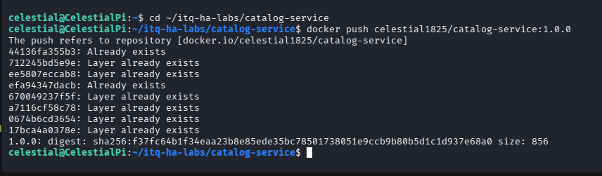
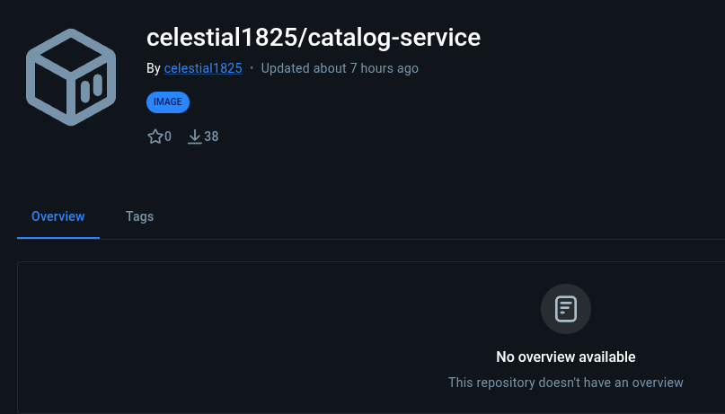
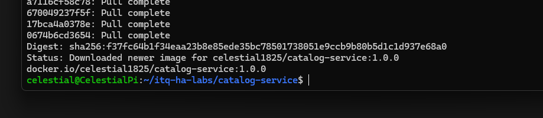
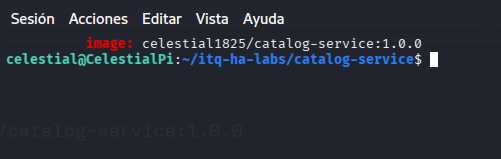
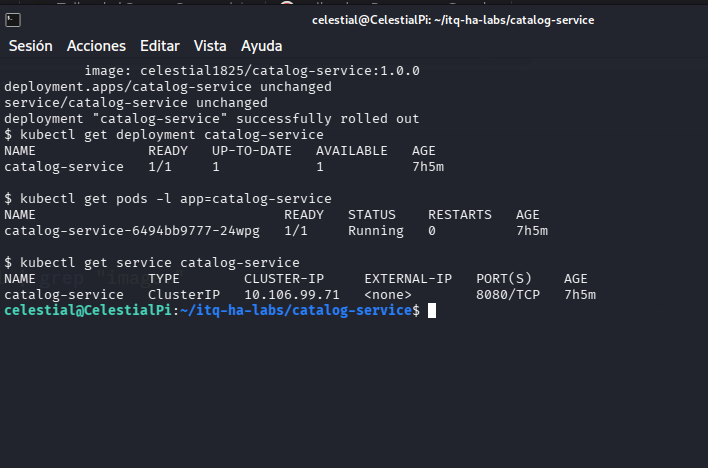
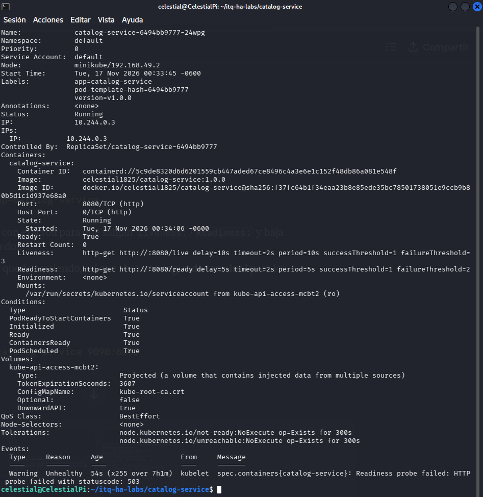
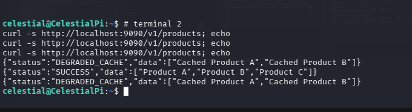
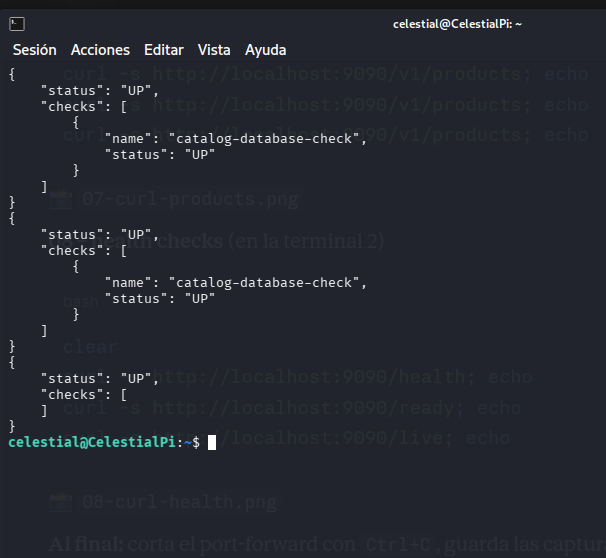

# Lab 1.3 – De Docker a Kubernetes local

Ángel Mauricio Flores Olivarez – Grupo 6V
Entorno: Raspberry Pi 5 (Ubuntu 24.04, ARM64), Minikube con driver Docker

La idea del lab es agarrar el `catalog-service` del 1.2 (ya con Timeout, Retry, CircuitBreaker y Fallback), meterlo en una imagen Docker, subirla a Docker Hub y desplegarla en Kubernetes local con los YAML de `catalog-service/k8s/`.

## Pasos que se hicieron

**0. Clúster local (una sola vez en la Pi)**

```bash
curl -LO https://github.com/kubernetes/minikube/releases/latest/download/minikube-linux-arm64
sudo install minikube-linux-arm64 /usr/local/bin/minikube
curl -LO "https://dl.k8s.io/release/$(curl -Ls https://dl.k8s.io/release/stable.txt)/bin/linux/arm64/kubectl"
sudo install kubectl /usr/local/bin/kubectl
minikube start --driver=docker
kubectl cluster-info && kubectl get nodes
```

**1. Build + push a Docker Hub**

```bash
cd catalog-service
docker login
./lab-1.3.sh build     # mvnw package, docker build, push, rm y pull desde Docker Hub
```

**2. YAML con mi imagen** – en `k8s/01-deployment.yaml` el campo quedó así:

```yaml
image: celestial1825/catalog-service:1.0.0
```

**3. Deploy en Kubernetes**

```bash
./lab-1.3.sh deploy    # kubectl apply de deployment y service + kubectl get
./lab-1.3.sh check     # describe pod + port-forward 9090:8080 + curl a los endpoints
```

> El port-forward va a `9090` porque en la Pi el `8080` ya está ocupado (igual que en el 1.1).

**4. Limpieza**

```bash
./lab-1.3.sh clean
```

Cada paso del script guarda su salida en esta carpeta (`docker-push.txt`, `docker-pull.txt`, `deployment-image.txt`, `kubectl-get.txt`, `describe-pod.txt`, `curl-endpoints.txt`).

---

## Evidencias

### 1. Imagen construida y publicada en Docker Hub

**`docker push` exitoso**



**Repositorio en Docker Hub con el tag `1.0.0`** (`https://hub.docker.com/r/celestial1825/catalog-service`)



**`docker pull` después de borrar la imagen local** ("Downloaded newer image")



### 2. YAML actualizado con mi repositorio

**`cat k8s/01-deployment.yaml | grep "image:"`**



### 3. Deployment en Kubernetes con health checks automáticos

**Pod en `Running` y `READY 1/1`** (`kubectl get deployment/pods/service`)



**`kubectl describe pod`**



Lo que se ve aquí:
- **La imagen viene de Docker Hub:** el `Image ID` es `docker.io/celestial1825/catalog-service@sha256:f37fc64b…`, el mismo digest que dio el `docker push` (captura 01).
- **Las probes están configuradas:** `Liveness: http-get :8080/live ... period=10s` y `Readiness: http-get :8080/ready ... period=5s`, con la condición `Ready True`.
- **Kubernetes las está ejecutando solo:** el evento `Readiness probe failed: HTTP probe failed with statuscode: 503 (x255 over 7h1m)` sale del 5 % de fallas simuladas en `ReadinessHealthCheck`. Llevaba 7 h corriendo y nadie hizo curl a mano, así que esas 255 revisiones las hizo Kubernetes. Aun así el pod siguió `Running` con 0 reinicios, porque para sacarlo del Service se necesitan 2 fallas seguidas y `/live` nunca falló.
- Los eventos `Pulling`/`Pulled` ya no aparecen porque Kubernetes borra los eventos después de ~1 h, y el pod llevaba 7 h arriba.

### 4. Validación del servicio

**`/v1/products`** respondiendo `SUCCESS` o `DEGRADED_CACHE`



**`/health`, `/ready`, `/live`** en `UP`



---

## Explicación técnica

Primero compilé el servicio con `./mvnw package` y armé la imagen con `docker build`, quedando como `celestial1825/catalog-service:1.0.0`. Luego la subí a Docker Hub con `docker push`, así ya se puede bajar desde cualquier máquina; para comprobarlo la borré localmente y la volví a bajar con `docker pull`.

Después edité `k8s/01-deployment.yaml` para que apunte a mi imagen. Ese archivo declara qué imagen usar y qué health checks correr: `readinessProbe` contra `/ready` cada 5 s y `livenessProbe` contra `/live` cada 10 s. Al hacer `kubectl apply`, Kubernetes no tenía la imagen dentro del clúster, así que la descargó de Docker Hub (se ve en los eventos `Pulling` y `Pulled`).

Lo importante es el cambio respecto al Lab 1.1: ahí revisé `/ready` y `/live` a mano con curl, y ahora Kubernetes los revisa solo. Si `/ready` falla, saca al pod del Service y deja de mandarle tráfico; si `/live` falla, reinicia el contenedor. Sin esto Kubernetes no sabría que un pod está dañado.

Flujo: build local → push a registry → deploy declarativo → Kubernetes valida automáticamente.

**Nota sobre los eventos de las probes:** Kubernetes no genera eventos cuando una probe *pasa*, solo cuando falla (`Unhealthy`). La prueba de que se están ejecutando es que en `describe pod` aparecen las líneas `Liveness:` y `Readiness:` con su configuración y la condición `Ready True`. Como `ReadinessHealthCheck` simula un 5 % de fallas, de vez en cuando sale un evento `Readiness probe failed`, y eso confirma que Kubernetes está llamando a `/ready` solo.
